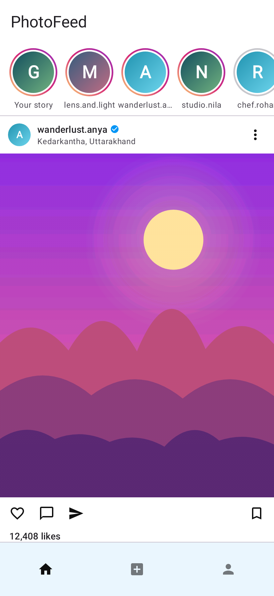
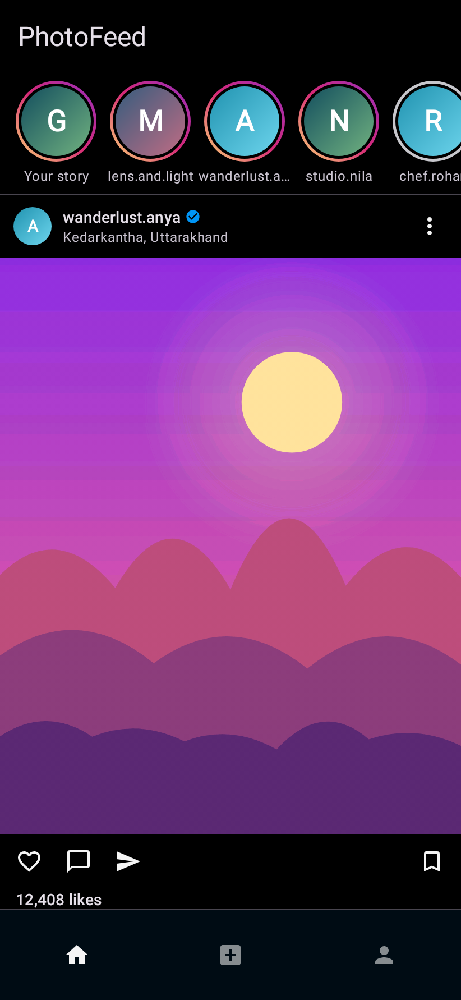
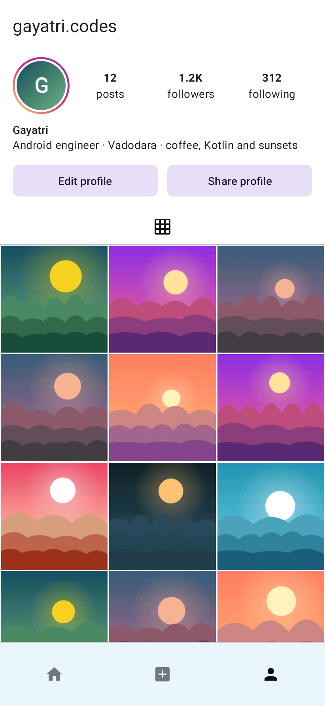
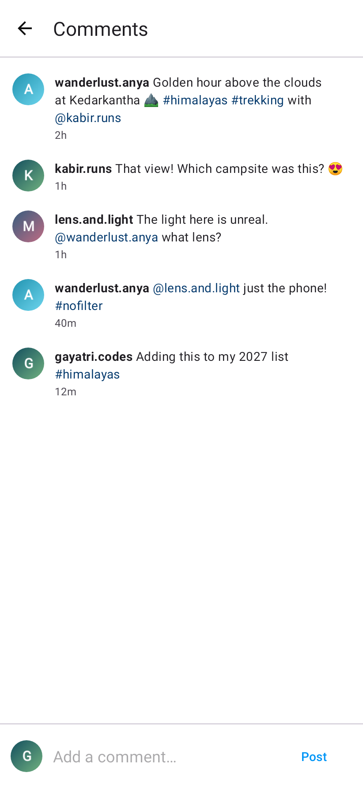
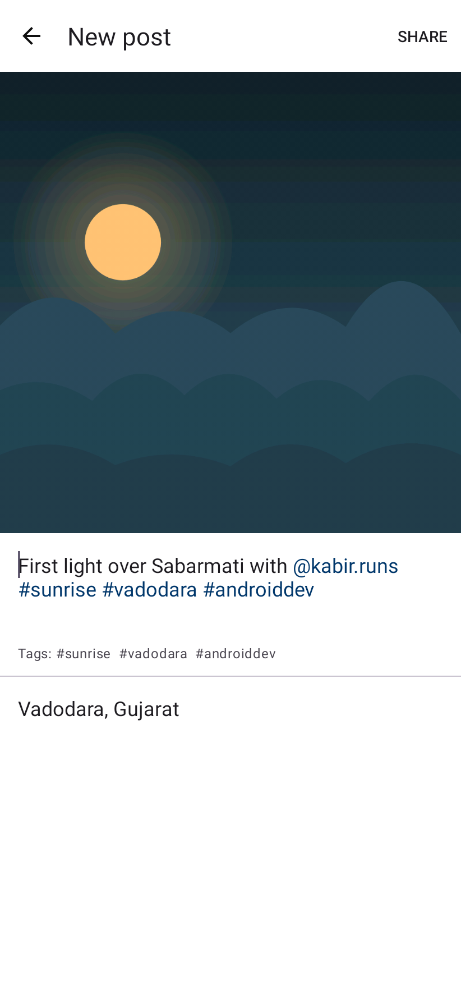

# PhotoFeed · Instagram-style photo feed (Java)

[](https://github.com/gayatripatel10091992/java-photofeed/actions/workflows/ci.yml)


A photo-sharing app with a stories row, an infinite feed with double-tap to like, comments, a profile grid and
posting from the Photo Picker. Written in **Java** with classic Android Views, from the period when I built Java
apps at Fusion Informatics. The focus is on **RecyclerView performance and bitmap memory**.

> Portfolio project. Original code; users are fictional and photos are generated on the device, so it runs offline.

## Screenshots

Rendered on the JVM by Robolectric (native graphics) in CI, from the real activities, fragments and XML layouts.

| Feed | Dark theme | Liked & saved | Profile grid | Comments | New post |
|---|---|---|---|---|---|
|  |  |  |  |  |  |

## What's inside

| Area | Implementation |
|---|---|
| **Feed** | One `RecyclerView` with stories header, posts and a loading/end footer. **Cursor pagination** (`FeedPager`) prefetches two items before the end; new posts at the top never duplicate or skip items on later pages. Synchronous `DiffUtil` with immutable `Post` objects. |
| **Interactions** | Double-tap the photo to like, with a heart pop animation (`GestureDetector` + `ViewPropertyAnimator`), optimistic like/save, comments with live counts, `#hashtag` and `@mention` highlighting (`CaptionParser` + spans). |
| **Images & memory** | `PhotoLoader`: background decode, `LruCache` sized to 1/8 of the heap and measured in KB, and request tags so recycled rows never flash the wrong photo. `AspectRatioImageView` reserves each row's height before the bitmap arrives (no layout jumps), with aspect ratios clamped to 4:5 to 1.91:1. Grid tiles decode at tile size. |
| **Posting** | System **Photo Picker** (no storage permission). Two-pass `inSampleSize` decode (`BitmapSampling`) turns a 12 MP photo (~46.5 MB as ARGB) into a ~1080 px bitmap off the main thread, saves it as a JPEG, and shows the saving on screen. |
| **Structure** | `MainActivity` with `BottomNavigationView` and show/hide fragments (feed scroll position survives tab switches), `FeedViewModel` with `MediatorLiveData`, View Binding, Material 3 DayNight, StrictMode in debug. |
| **Tests** | 7 JUnit tests on the pure-Java `core` (counts, ages, caption parsing, pagination, likes, sampling) and 6 Robolectric screenshot tests. |

```
core/   pure Java: Post, User, Comment, FeedPager, CaptionParser, Formats, BitmapSampling, SampleFeed
app/    data/   FeedRepository (in-memory API stand-in, LiveData)
        image/  PhotoLoader (LruCache, sampling) · PhotoArt (generated photos/avatars)
        ui/     MainActivity · FeedFragment · ProfileFragment · CommentsActivity · CreatePostActivity · adapters
```

## Build

```bash
./gradlew :core:test              # pure Java logic
./gradlew :app:testDebugUnitTest  # Robolectric UI tests, writes app/build/outputs/screenshots
./gradlew assembleDebug
```

## License

MIT
